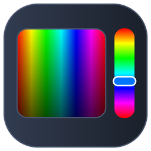

# Palette

一个 Win32 + GDI+ 的**取色 / 调色 / 配色**小工具：拖一拖方块选颜色，右边立刻给出 HEX、RGB、HSV、HSL、CMYK 五组数值，点一下就能复制。

整窗自绘（没有任何布局控件），只有数值编辑用一个原生 `EDIT` 子控件叠在自绘的行上。程序本身约 3000 行 C++（10 个 `.cpp` + 11 个头文件，按层分在 `src\` 下），不依赖任何第三方 GUI 库。



---

> **当前版本：v1.0**（2026-11-05）—— 首个正式版本：四层结构（`color` / `platform` / `ui` / `app`），
> `color/` 是零 Win32 依赖的纯色彩数学层，配 765 条断言；界面另有 24 项截图冒烟测试。

---

## 目录

- [功能特性](#功能特性)
- [第一部分：如何使用](#第一部分如何使用)
  - [1. 界面与操作](#1-界面与操作)
  - [2. RGB 调节](#2-rgb-调节)
  - [3. 数值编辑](#3-数值编辑)
  - [4. 配色方案与最近使用](#4-配色方案与最近使用)
- [第二部分：如何从源码编译](#第二部分如何从源码编译)
  - [环境准备](#环境准备)
  - [方式一：双击 build.bat（推荐）](#方式一双击-buildbat推荐)
  - [方式二：手动执行命令](#方式二手动执行命令)
  - [构建系统做了什么](#构建系统做了什么)
  - [单元测试](#单元测试)
  - [界面冒烟测试](#界面冒烟测试)
- [项目结构](#项目结构)
- [源码架构说明](docs/ARCHITECTURE.md)
- [工作原理](#工作原理)
- [图标](#图标)
- [常见问题](#常见问题)
- [踩过的坑](#踩过的坑)
- [更新历史](#更新历史)
- [关于 AI 使用](#关于-ai-使用)

---

## 功能特性

- **一个取色器方块 + 一条色相条**：拖动即取色，比在系统取色器里点色轮更直接
- **五种色彩空间同时显示**：HEX / RGB / HSV / HSL / CMYK，全部可读可写
- **数值双向同步**：改任何一组数值，其余四组、预览色块、配色色块全部跟着走
- **RGB 滑条**：直接调 R / G / B 三个通道，轨道是各自通道从暗到亮的渐变；滚轮微调，`Ctrl`+滚轮步长 10
- **六种配色方案**：互补 / 邻近 / 三角 / 分裂互补 / 四方 / 单色，一键生成 5 个色块
- **最近使用**：取过的颜色自动留档，点一下就回来
- **点行尾复制**：任意一行数值（含 HEX）单击即进剪贴板，`Ctrl+C` 直接复制 HEX
- **灰度不丢色相**：颜色调成黑 / 白 / 灰时，色相条不会莫名其妙跳回红色
- **整窗自绘 + 高 DPI**：Per-Monitor V2，任何缩放下比例一致
- **单一 exe**：不需要安装，`bin\Palette.exe` 拷走就能用

---

# 第一部分：如何使用

## 1. 界面与操作

左边是取色卡（饱和度 / 明度方块 + 竖排色相条 + 预览色块），右边自上而下依次是五行颜色数值、RGB 滑条、配色方案与色块。

| 操作 | 效果 |
|---|---|
| 拖动方块 | 取饱和度 / 明度 |
| 拖动色相条 | 取色相 |
| 在方块上滚滚轮 | 微调色相 |
| **拖 RGB 滑条** | **直接调 R / G / B，画面同步跟着变** |
| 在 RGB 滑条上滚滚轮 | 微调该通道（按住 `Ctrl` 步长 10） |
| **点右侧数值** | **进入编辑，直接改色** |
| 点行首标签或行尾「复制」 | 把该行数值复制到剪贴板 |
| 点配色芯片 | 切换配色方案 |
| 点配色色块 / 最近使用 | 应用该颜色 |
| `Ctrl+C` | 复制 HEX |

- 窗口最小尺寸 **980 × 750**（逻辑像素）：低于这个尺寸布局会塌，所以用 `WM_GETMINMAXINFO` 锁住（`app.cpp` 的 `kMinWidthLogical / kMinHeightLogical`）。
- 所有尺寸先按 96 DPI 的逻辑像素写死，再乘 DPI 缩放系数，所以 125% / 150% / 175% 下比例一致。

## 2. RGB 调节

「RGB 调节」卡里有 R / G / B 三条滑条，轨道是各自通道从暗到亮的渐变，旋钮位置就是当前通道值（右边同时显示数字）。

拖动任意一条，**其余两条不动** —— 只改那一个通道。改完之后：

- 左边的取色器方块和色相条**跟着走到对应的颜色**（色相变了，色相条上的当前色标记也会移位）；
- 预览色块、五行数值、配色色块全部同步刷新；
- 右侧的数值仍然可以继续手写改色，两条入口互相补足。

滑条上滚滚轮可以微调（一次 1，按住 `Ctrl` 一次 10）。

## 3. 数值编辑

右侧「颜色数值」卡片五行都能改：

| 行 | 接受 | 例 |
|---|---|---|
| HEX | `#RGB` / `#RRGGBB` / `0xRRGGBB`，`#` 可省 | `#12AB34`、`38D` |
| RGB | `rgb(r, g, b)` 或裸的 `r, g, b`，0–255 | `rgb(255, 128, 0)` |
| HSV | `hsv(h, s%, v%)`，角度 0–360 | `hsv(120, 100%, 100%)` |
| HSL | `hsl(h, s%, l%)` | `hsl(240, 100%, 50%)` |
| CMYK | `cmyk(c%, m%, y%, k%)` | `cmyk(100%, 0%, 0%, 0%)` |

- 百分比可以带 `%` 也可以不带；饱和度写成 `0.73` 这样的分数也认。
- 全角字符（`，` `％` `（）` 全角数字）会自动转成半角，中文输入法直接打就行。
- **回车**提交，**Esc** 放弃，**Tab / Shift+Tab** 在五行之间跳。
- 点别处也会提交；格式不对会弹提示并且**不改颜色**。
- 编辑灰度时色相会被保留（灰没有自己的色相），色相条不会跳回红色。

## 4. 配色方案与最近使用

点配色芯片切换方案，右边立刻重算 5 个色块；点任一色块即应用该颜色。取过的颜色会自动进入"最近使用"列表。

六种方案的取色规则：

| 方案 | 相对当前色相的角度 |
|---|---|
| 互补 | +180° |
| 邻近 | ±20°、±40° |
| 三角 | +120°、+240° |
| 分裂互补 | +150°、+210° |
| 四方 | +90°、+180°、+270° |
| 单色 | 色相不变，明度递减 |

---

# 第二部分：如何从源码编译

工程是标准 C++ 布局：根目录放 `CMakeLists.txt` + `src/` + `tests/` + `assets/` + `docs/`，
编译中间文件全在 `build/`，成品输出到 `bin\`。

## 环境准备

| 需要 | 用途 | 说明 |
|---|---|---|
| **MinGW-w64** | `g++.exe` 编译、`windres.exe` 嵌图标 | 确认 MinGW-w64 安装目录的 `bin\` 下有 `g++.exe`、`windres.exe`、`mingw32-make.exe`（在 `PATH` 上即可） |
| **CMake ≥ 3.16** | 构建 | 装官方安装包即可；本机若没有，可在 `.build.local.bat` 设 `CMAKE` 指向任意一份，`build.bat` 会自动找 |
| Python + Pillow | **只有改图标才需要** | `tools\make_icon.py` 用来重新生成 `.ico`；不碰图标就不用管 |

## 方式一：双击 build.bat（推荐）

根目录的 `build.bat` 是个薄封装：找 cmake → 挑工具链 → 配置 → 编译。脚本内部 `cd /d "%~dp0"`，从哪儿双击都行。

工具链的选择规则是：**PATH 里有 MSVC（`cl.exe`）就用 MSVC，否则用 MinGW-w64（在 `PATH` 上，或在 `.build.local.bat` 指定）**。

```
[INFO] Using MinGW toolchain from <你的 MinGW bin 目录>.
[1/3] configure ...
[2/3] build ...
Build OK: bin\Palette.exe
```

> `build.bat` 刻意只用 **ASCII + CRLF**：`.bat` 里写中文在 GBK 控制台下会乱码，
> 纯 LF 换行则会让 `^` 续行解析出错（这两条 `.editorconfig` 里也标了）。

## 方式二：手动执行命令

在项目根目录（`CMakeLists.txt` 那一层）执行：

```bat
cmake -S . -B build -G "MinGW Makefiles" -DCMAKE_BUILD_TYPE=Release
cmake --build build
ctest --test-dir build --output-on-failure
```

## 构建系统做了什么

| 配置 | 作用 |
|---|---|
| `project(Palette VERSION 1.0.0.0 LANGUAGES CXX)` + `enable_language(RC)` | RC 语言必须显式打开，否则 `.rc` 不进 target，图标和版本号都会丢 |
| `add_executable(Palette WIN32 ...)` | `WIN32` = GUI 子系统（`-mwindows`），运行不弹黑框 |
| `target_include_directories(Palette PRIVATE src)` | 源码里照旧写 `#include "color/color.h"` |
| `CMAKE_RC_FLAGS += -I src/app -I assets` | `.rc` 里用 `"palette.ico"` 引用图标，得让资源编译器找得到 |
| `-static -static-libgcc -static-libstdc++` | 静态链运行库，分发的 exe 不依赖额外 DLL |
| `RUNTIME_OUTPUT_DIRECTORY = bin` | 成品落在 `bin\`，全工程只有这一份 exe |
| `OBJECT_DEPENDS app.rc → assets/palette.ico` | 改了图标必须重跑 `windres`，挂进依赖图免得忘了 |
| `enable_testing()` + `tests/` | CTest 跑 `test_color` |

## 单元测试

`color/` 这一层是纯 C++（不 `#include <windows.h>`），所以可以直接编成控制台程序跑，不开窗口、秒级结束：

```bat
ctest --test-dir build --output-on-failure
:: 或者直接跑，看逐条结果
build\tests\test_color.exe
```

`tests/test_color.cpp` 现在 **765 条断言**（其中有 360×3×3 的往返网格），覆盖：

| 组 | 内容 |
|---|---|
| RGB ↔ HSV | 定点色、越界色相绕回、饱和度/明度钳制、网格往返（色相 ±1.5°、S/V ±0.02） |
| RGB ↔ HSL / CMYK | 纯色与灰阶边界、CMYK 黑白端点 |
| 文本格式 | `ToHex` / `ToCssRgb` / `ToCssHsv` / `ToCssHsl` / `ToCssCmyk` 与界面显示逐字一致；359.7° 必须显示成 0° |
| 打包 | `Argb()` 的 `0xAARRGGBB`；`ToByte()` 的四舍五入与钳制 |
| HEX 解析 | `#RGB` / `0xRRGGBB` / 大小写 / 前后空格 / 非法长度与非十六进制字符 |
| 其它解析 | 百分比、分数写法、越界钳制、分量个数不对、全角数字与全角括号逗号 |
| 配色方案 | 六种都返回 5 个颜色；互补 +180°、邻近 ±20/40°、三角 +120/240°、四方 +90/180/270°、单色调明度递减 |

没有引第三方测试框架（一个 `CHECK` 宏 + 计数），以后想换 Catch2 / GoogleTest，只改 `tests/` 即可，顶层 CMake 不用动。

## 界面冒烟测试

Palette 是全自绘窗口，没有可读文本的子控件，所以测试靠两件事确认状态：

1. **截图**：`PrintWindow(PW_RENDERFULLCONTENT)` 抓客户区，靠「行背景色」定位 5 行数值框 —— 不写死坐标，改布局也不会失效。
2. **剪贴板**：点行尾「复制」，程序把该行数值写进剪贴板，于是能拿到精确的 HEX 文本，用来判断颜色到底变没变。

```bat
python tools\ui_check.py
```

覆盖 **24 项**：定位数值行、点复制读回 HEX、写 HEX/RGB/HSV/HSL/CMYK 改色、非法输入不改色、Esc 取消、Tab 换行、点标签复制、拖方块改色、RGB 滑条定位 / 精确落点 / 只动单个通道、拾色器跟随 RGB、拖动滑条、最小尺寸不塌。

它和 `tests/` 分工不同：**改色彩算法 / 解析规则跑 `tests/`（无窗口）；改布局 / 交互跑 `ui_check.py`（真开窗口、靠截图与剪贴板核对）。**

`tools\shoot_window.py` 是另一件事：抓一张**带标题栏**的整窗截图，并核对 `WM_GETICON` 拿到的图标句柄和尺寸（任务栏和 Alt+Tab 靠它）。

> 测试进程自己声明 Per-Monitor V2，否则 `GetWindowRect` 拿到的是系统虚拟化过的尺寸，
> `PrintWindow` 只会截到窗口左上角一块。

---

## 项目结构

```text
Palette_v1.0/
├── CMakeLists.txt             构建入口（MSVC / MinGW 都能编）
├── build.bat                  Windows 一键编译：找 cmake → 挑工具链 → 配置 → 编译
├── README.md
├── .gitignore                 build/、*.o、*.exe、Python 缓存
├── .clang-format              代码风格（4 空格 / 100 列 / 大括号不换行）
├── .editorconfig              缩进与换行统一（.bat 强制 CRLF）
│
├── bin\                       ← 成品（全工程只有这一份 exe）
│   └── Palette.exe            双击运行
│
├── assets/
│   ├── palette.ico            程序图标（嵌进 exe，唯一构建输入）
│   └── palette.png            README 预览图（从 .ico 导出的 256px）
│
├── src/
│   ├── main.cpp               入口：DPI 感知 → GDI+ 启动 → 建窗 → 消息循环
│   │
│   ├── color/                 ① 纯色彩数学，不含任何 Win32 依赖
│   │   ├── color.h / .cpp         RGB / HSV / HSL / CMYK 互转 + CSS 格式化
│   │   ├── harmony.h / .cpp       六种配色方案
│   │   └── parse.h / .cpp         解析用户手输的数值
│   │
│   ├── platform/              ② 系统能力薄封装
│   │   ├── dpi.h / .cpp           Per-Monitor V2、DPI 缩放、DPI 感知的窗口尺寸
│   │   └── clipboard.h / .cpp     剪贴板写文本
│   │
│   ├── ui/                    ③ 纯绘制层：只管画，不管交互
│   │   ├── gdiplus_include.h      统一封装 gdiplus 头（跨 MSVC / MinGW）
│   │   ├── theme.h / .cpp         设计令牌：配色 + 字体（DPI 变化时重建）
│   │   ├── layout.h / .cpp        由客户区尺寸算出所有控件矩形
│   │   └── render.h / .cpp        圆角、渐变、描边、文本等绘制原语
│   │
│   └── app/                   ④ 应用壳：消息、命中测试、状态机
│       ├── app.h / .cpp           窗口过程、自绘、拖拽、编辑框、复制/提示
│       ├── app.rc                 资源：图标 + 版本信息（VS_VERSION_INFO）
│       └── resource.h             资源 ID 定义
│
├── tests/
│   ├── CMakeLists.txt
│   └── test_color.cpp         765 条断言（CTest，只测 color/ 纯逻辑层）
│
├── tools/                     开发期脚本（不属于构建）
│   ├── make_icon.py           图标渲染引擎
│   ├── ui_check.py            界面冒烟测试（24 项断言）
│   └── shoot_window.py        整窗截图 + 核对窗口图标句柄
│
├── docs/
│   └── ARCHITECTURE.md        分层图、数据流、布局/编辑框细节、坑
│
└── build/                     **CMake 生成**：编译中间文件（不入库，可随时删）
```

| 位置 | 作用 |
|---|---|
| `CMakeLists.txt` | 顶层构建脚本：源文件清单、`-I` 路径、链接库、测试入口 |
| `build.bat` | 一键编译，自动挑工具链 |
| `bin\` | 成品：`Palette.exe`；整个目录拷走即用 |
| `assets/` | 只放**构建输入**：图标与 README 图 |
| `src/color/` | 纯数学，可单独拿去用或做单测 |
| `src/platform/` | DPI 与剪贴板，不认识界面 |
| `src/ui/` | 所有绘制原语与布局计算 |
| `src/app/` | 窗口过程、交互状态机、资源脚本 |
| `tests/` | CTest 单元测试（只链 `color/`） |
| `tools/` | 开发期脚本，不参与构建 |
| `docs/ARCHITECTURE.md` | 改代码前先看这份 |
| `build/` | CMake 生成物，`.gitignore` 已忽略 |

依赖方向只有一条：**`app` → `ui` / `platform` / `color`**，
`color` 完全不依赖 Win32；细节见 [`docs/ARCHITECTURE.md`](docs/ARCHITECTURE.md)。

## 工作原理

```
   用户拖动方块 / 色相条 / RGB 滑条 / 手输数值
                 │
                 ▼
        app::Application（命中测试 / 状态机）
                 │
                 ▼
          color::Hsv        ← 唯一的权威编辑状态
                 │
                 ├─► color::RgbFromHsv ──────► 预览色块 / HEX / RGB
                 ├─► color::HslFromRgb ──────► HSL 行
                 ├─► color::CmykFromRgb ─────► CMYK 行
                 └─► color::HarmonyPalette ──► 5 个配色色块
                 │
   手输数值 ─► color::Parse* ─► 折回 Hsv
```

**为什么以 HSV 为准**：颜色变成黑 / 白 / 灰时，RGB 里已经没有色相信息了，
HSV 能把色相留住，色相条不会莫名其妙跳回红色。

**RGB 调节卡是另一条入口**：它直接改 R / G / B 三个通道，再经 `HsvFromRgb` 折回 HSV。
所以拖滑条时色相条上的当前色标记、预览色块、配色色块全都同步跟着走 ——
不会只改 RGB 数值而画面不动。

**布局的唯一来源**是 `ui::BuildLayout(clientWidth, clientHeight, scale)`：
输入客户区尺寸（物理像素）和 DPI 缩放，输出所有矩形的物理像素坐标。
所有尺寸先按 96 DPI 的逻辑像素写死，再乘缩放系数，所以任何 DPI 下比例一致。

## 图标

图标是**程序拾色器的微缩版**：

| 元素 | 对应程序里的什么 |
|---|---|
| 深色圆角底 | 应用卡片的深色主题（`#333D52 → #1A2029`） |
| 左侧彩虹方块 | 色相场 —— 横向铺满整个色相环，纵向由亮压到 30% |
| 右侧竖条 | 色相条，7 个色标顺序与应用里的 `hueStops` 完全一致 |
| 白色圆点 | 取色点（白心 + `#20242C` 描边，与应用里的 marker 同款） |
| 条上的蓝环 | 当前色的纯色相 `#0075FF`（默认色 `#3A83D6` 的色相 212°） |

**为什么方块用「色相环」而不是应用里的「饱和度/明度方块」**：应用里 SV 方块横轴是饱和度，
整个方块只有一种色相，缩到 16px 一平均就是一块灰蓝色，整个图标看着像「灰盒子 + 一条彩带」。
图标要的是「这是个颜色工具」，所以方块横轴改成色相：任何尺寸下方块本身就是彩色的。

**怎么改**：图标由 `tools\make_icon.py` 生成，几何按 256px 参考画布写死，渲染时放大 4 倍再 LANCZOS 缩回，
每个尺寸单独渲染一次（不靠缩图），所以 16px 也不糊。`.ico` 里带 16/20/24/32/40/48/64/96/128/256 共 10 档。

```bat
python tools\make_icon.py
```

改了 `.ico` 记得重跑 `build.bat`：`CMakeLists.txt` 里用 `OBJECT_DEPENDS` 把图标挂进了资源编译器的依赖图，CMake 会自动重新编 `.rc`。

> 版本号在 `src\app\app.rc` 的 `VS_VERSION_INFO` 里（`1,0,0,0`），与 `CMakeLists.txt` 的
> `project(Palette VERSION 1.0.0.0)` 保持一致。文件属性里能看到「产品名称 / 文件版本 / 说明 / 语言」。

## 常见问题

**Q：颜色调成黑色或灰的以后，为什么色相条没跳回红色？**
这是**故意的**。灰没有自己的色相，如果以 RGB 为准就会丢掉色相信息；程序以 HSV 为准，
所以把明度拉到 0 时色相仍被保住，往回拉还回原来那个颜色。

**Q：手动填的 HEX 回车后没生效？**
回车才算提交（`Esc` 是放弃）。格式不对会弹提示并且**不改颜色**：
`#RGB`、`#RRGGBB`、`0xRRGGBB` 都认，但 `#12345` 这种长度不对的会被拒。中文输入法下的全角字符会自动转半角。

**Q：为什么数值框看着像普通文字，不像输入框？**
它就是一个**叠在自绘行上的原生 `EDIT`**：光标、选区、`Ctrl+V`、中文输入法全都白送，
背景色用 `WM_CTLCOLOREDIT` 设成和行底色一致，所以看起来是「行内可编辑」而不是浮在画面上的一个框。

**Q：改了布局以后 `ui_check.py` 全红？**
脚本是按**行背景色**定位数值行的，不写死坐标。如果整段行号错位一位，多半是新的悬停底色没有加进识别列表——
脚本要同时认 `row` 和 `rowHover` 两种底色（曾经因此把 HSL 写进了 CMYK 行，看起来像「解析功能坏了」）。

**Q：改了 `.ico`，资源管理器里显示的还是旧图标？**
Windows 按路径缓存图标（`iconcache*.db`），跟 exe 是否真更新无关。
确认 exe 真的换了图标用 `tools\shoot_window.py`（核对 `WM_GETICON` 的句柄与尺寸），不要只凭资源管理器的缩略图判断。

**Q：能直接复制 HEX 吗？**
能。`Ctrl+C` 复制 HEX；也可以点右侧任意一行的行尾「复制」按钮，把那行的**原始文本**（比如完整 `rgb(58, 131, 214)`）复制走。

---

## 踩过的坑

- **`WM_CTLCOLOREDIT` 的控件句柄在 `lParam`**，`wParam` 是 HDC。写反了不报错，只是编辑器配色不上。
- **父窗口吞掉 `WM_LBUTTONDOWN`（没调 `DefWindowProc`）→ 系统不会把焦点移走**，编辑框也就收不到 `EN_KILLFOCUS`。所以「点别处提交」必须自己实现，不能指望焦点。
- **`SetWindowSubclass` + `WM_GETDLGCODE` 返回 `DLGC_WANTALLKEYS`**，回车 / Esc / Tab 才会送到子窗口，否则会被默认处理吞掉。
- **GDI+ 的 `FillGradientRounded` 用 `ResetClip()` 会把调用方的裁剪区一起丢掉**，要用 `GraphicsState` 保存 / 恢复。
- **`GetProcAddress` 的返回值直接 `reinterpret_cast` 成函数指针会触发 `-Wcast-function-type`**，用 `memcpy` 过一下最干净。
- **一个 `.ico` 只挂一个资源 ID**：分成大/小两组会让 exe 里出现两个 `RT_GROUP_ICON`，而资源管理器只认 ID 最小的那组。多尺寸的 `.ico` 里 `LoadIcon` / `LoadImage` 会自己挑，拆成两组纯属白占体积。
- **只设类图标不够**：标题栏会自己去取类图标画，但任务栏按钮和 Alt+Tab 走的是 `WM_GETICON`（窗口自己的图标），不显式 `WM_SETICON` 一次的话它们拿到的是 NULL。
- **画渐变时要把图「贴」到控件位置，不能拉伸铺满画布再靠遮罩裁**：后者会让控件只显示渐变中段（色相环的红色和品红直接消失），非常难查。
- **悬停态的行底色是 `rowHover`，和常态的 `row` 不是同一个值**：任何按底色识别行的脚本都得两种都认，否则会漏掉悬停的那一行、行号整体错位。应用这边也要注意：编辑框打开时那一行固定画 `row`，否则行底色是 `rowHover`、编辑框背景却是 `row`，中间会露出一圈色差。
- **文本编辑器用原生 `EDIT` 子控件**：比自绘一个"能打字的框"省事得多，输入法、密码键盘、拖选全都现成。

---

## 更新历史

### v1.0 — 2026-11-05

首个正式版本。

- **四层结构**：`color`（零 Win32 的纯色彩数学）→ `platform`（DPI / 剪贴板）→ `ui`（绘制原语与布局）→ `app`（窗口过程与状态机）；
  依赖方向固定为 `app → ui / platform / color`。
- **取色器**：饱和度 / 明度方块 + 色相条，拖动即取色，滚轮微调色相。
- **五种色彩空间**：HEX / RGB / HSV / HSL / CMYK 同时显示，任意一组可改，其余四组同步。
- **RGB 滑条**：三条通道滑条直接调 R / G / B，轨道是各自通道的渐变，滚轮微调（`Ctrl` 步长 10）。
- **六种配色方案**：互补 / 邻近 / 三角 / 分裂互补 / 四方 / 单色，各生成 5 个色块。
- **行内数值编辑**：原生 `EDIT` 叠在自绘行上，回车提交、Esc 放弃、Tab 换行；全角字符自动转半角。
- **单元测试**：`tests/test_color.cpp` 765 条断言（含 360×3×3 往返网格），CTest 驱动。
- **界面冒烟测试**：`tools/ui_check.py` 24 项，靠「行背景色定位 + 剪贴板读回 HEX」核对。
- **工程化**：`CMakeLists.txt` 单一构建入口、`build.bat` 自动挑工具链、`.clang-format` / `.editorconfig`、
  成品收进 `bin\`、图标由 `tools/make_icon.py` 程序化生成（10 档尺寸，每档单独渲染）。

## 关于 AI 使用

> 本项目由 AI 在人类作者实质性指导下生成，按 MIT 许可证授权。
>
> AI 生成的代码可能存在人类未察觉的疏漏，请自行评估 AI 生成代码的质量与安全性，本项目不提供任何形式的担保。
